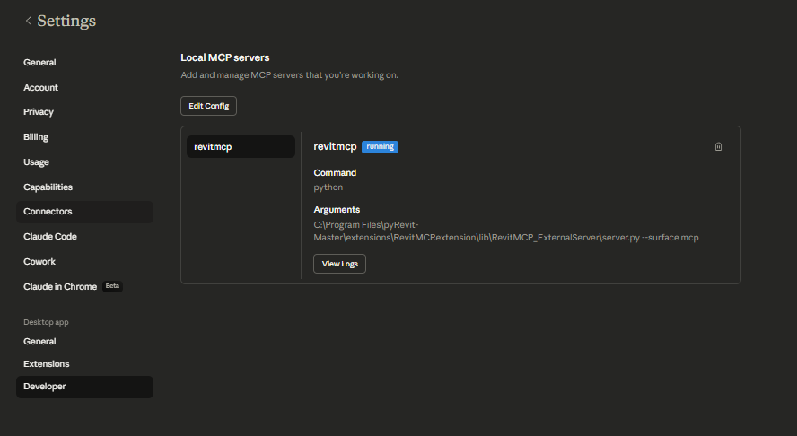

# pyRevit MCP Server Bridge
## Live Model Context Protocol (MCP) Bridge for Autodesk Revit

[](https://www.autodesk.com/products/revit)
[](https://github.com/eirannejad/pyRevit)
[](https://www.python.org/)
[](LICENSE.md)
[](https://modelcontextprotocol.io/)

A pyRevit extension and companion Flask-based Model Context Protocol (MCP) server that connects autonomous AI agents (Claude, Gemini, Antigravity, custom LLMs) directly into an **active Autodesk Revit session**.

Instead of copy-pasting data or relying on static script runs, the agent can inspect your model schema, query elements, format schedules, modify family types, and execute safe, atomic Revit API transactions in real time.

---

## Key Features

* **Live Session Automation:** Bridges modern LLM reasoning directly to Revit without requiring full standalone add-in recompilation.
* **Atomic Revit API Transactions:** Safely executes Python / Revit API code through pyRevit routes inside controlled `Transaction` blocks.
* **Headless Warning Suppression:** Integrates `IFailuresPreprocessor` (`failuresAccessor.DeleteAllWarnings()`) to prevent modal dialog popups from freezing headless agent execution.
* **Performance-Aware Architecture:** Designed to avoid `doc.Regenerate()` bottlenecks in loops, protecting large cloud-workshared models from session hangs.
* **Rich Toolset:**
  * Active view element querying and bounding-box inspection
  * Room and tag family type adjustments
  * Parameter synchronization and batch overrides
  * Schedule extraction, comparison, and formatting
  * Dynamic script execution (`execute_revit_script` via `/revit/exec`)

---

## Architecture

```
┌─────────────────────────────────┐
│        AI Agent / LLM           │
│   (Claude, Gemini, Antigravity) │
└────────────────┬────────────────┘
                 │ MCP / JSON-RPC Tools
                 ▼
┌─────────────────────────────────┐
│  pyRevit MCP External Server    │
│    (Flask on localhost:8000)    │
│  - Runtime configuration        │
│  - Tool routing & validation    │
└────────────────┬────────────────┘
                 │ Local HTTP / REST API
                 ▼
┌─────────────────────────────────┐
│   pyRevit Routes API In-Memory  │
│   (startup.py inside Revit.exe) │
│  - Transaction management       │
│  - Revit API Execution Engine   │
└─────────────────────────────────┘
```

---

## Quick Start & Installation

### 1. Prerequisites
* **Autodesk Revit 2024** (or compatible 2023+ release)
* **pyRevit 4.8.10+ / pyRevit 5.0+**
* **Python 3.10 or 3.11** installed on your system

### 2. Install the Extension
Clone or copy this repository into your pyRevit custom extension folder:

```bash
git clone https://github.com/Hazemalisakr/pyRevit-MCP-Server-Bridge.git "C:\pyRevitExtensions\RevitMCP.extension"
```

In Revit:
1. Navigate to **pyRevit tab -> Settings -> Custom Extension Directories**.
2. Add the parent folder (e.g. `C:\pyRevitExtensions`).
3. Click **Save Settings** and **pyRevit -> Reload**.
4. You will see the **RevitMCP** tab appear on your ribbon.

### 3. Install Server Dependencies
Open a terminal in the root directory:

```bash
pip install -r requirements.txt
```

Optional: Copy `.env.example` to `.env` to configure custom host/port settings.

### 4. Start the Bridge
* **From Revit Ribbon:** Click **RevitMCP tab -> Server panel -> Launch RevitMCP**.
* **Or via Terminal:**
  ```bash
  python lib/RevitMCP_ExternalServer/server.py --surface mcp
  ```
  The bridge server will initialize on `http://127.0.0.1:8000`.

---

## Connecting to AI Agents

### Claude Desktop Configuration (`claude_desktop_config.json`)

Add the server to your Claude Desktop configuration:

```json
{
  "mcpServers": {
    "revit-mcp": {
      "command": "python",
      "args": [
        "C:\\pyRevitExtensions\\RevitMCP.extension\\lib\\RevitMCP_ExternalServer\\server.py",
        "--surface",
        "mcp"
      ]
    }
  }
}
```

Once configured, Claude Desktop will automatically connect to your live Revit session:



### Antigravity / Agentic Environments
Configure the tool definitions provided in the `routes/` schema to point to `http://127.0.0.1:8000`.

---

## Safety & Model Integrity

* **Transactions:** All write operations run inside explicit `revit.Transaction` blocks.
* **Group Protection:** Workflows enforce group ID checking (`element.GroupId != InvalidElementId`) so detail or model groups are never accidentally unlinked.
* **View-Scoped Scoping:** Queries target active viewports (`sheet.GetAllViewports()`) rather than full-model scans to maintain low memory footprints.

---

## License

This project is licensed under the [MIT License](LICENSE.md).

## Contributing & Community

Contributions, issues, and feature requests are welcome. Feel free to check the [issues page](https://github.com/Hazemalisakr/pyRevit-MCP-Server-Bridge/issues) or submit a pull request.
